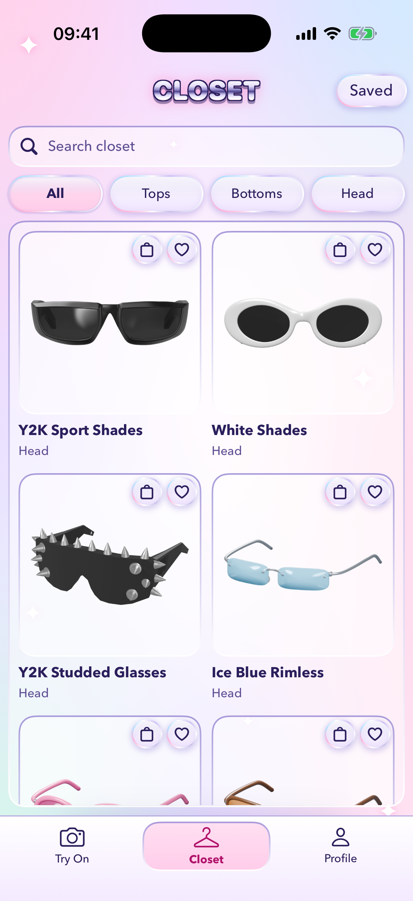
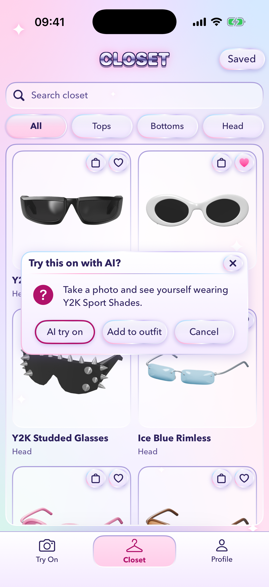
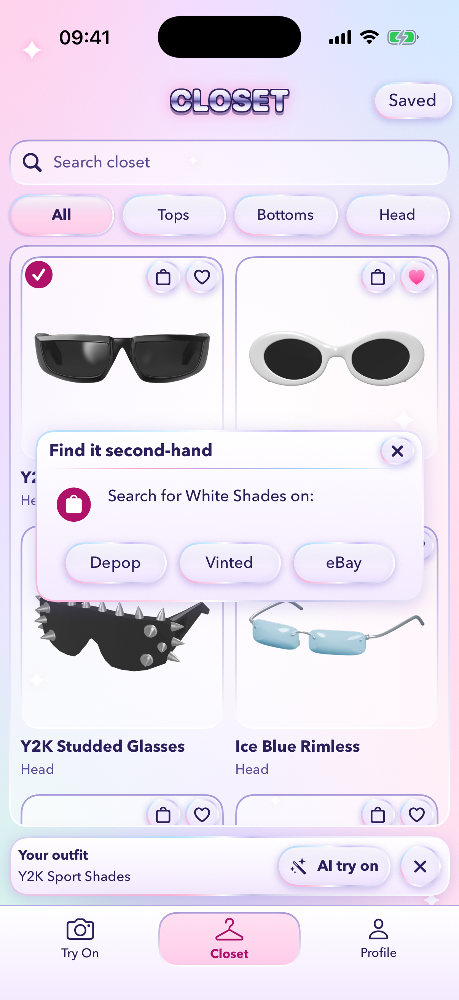
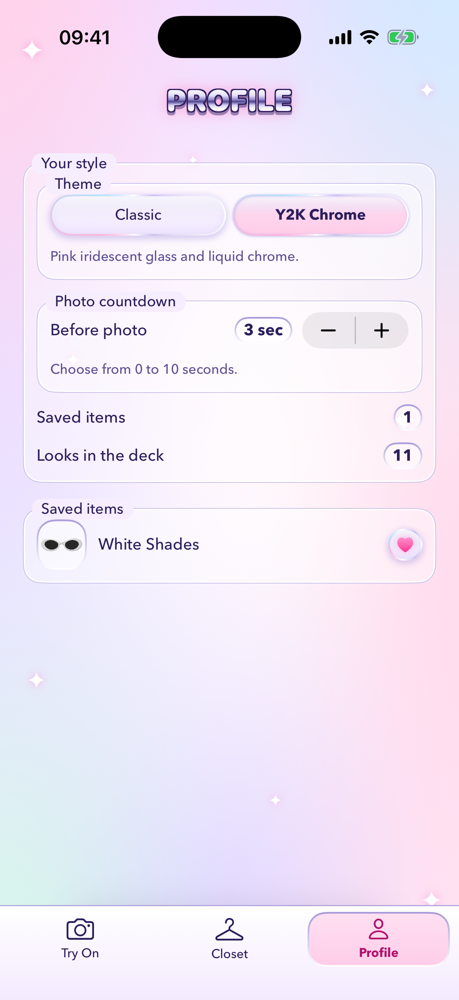

# RetroFit

**Try on Y2K fashion with AR and AI, then find it second-hand.**

RetroFit is an iPhone app for trying on Y2K pieces before you buy them. Your front camera puts 3D glasses, hats and accessories on your face in real time. An AI model shows you wearing any top or outfit. When you find something you love, one tap searches Depop, Vinted or eBay for it second-hand.

Built in 24 hours at [HackNotts '26](https://hacknotts.com) by Theo Rook and Rafferty Carter-Lazenbury.

| Closet | AI try-on | Find it second-hand | Two themes |
| --- | --- | --- | --- |
|  |  |  |  |

## Features

- **Live AR try-on.** ARKit tracks your face and RealityKit fits each 3D model to your eyes and head pose every frame. Swipe through the looks and tap Like to save the pieces you love.
- **AI try-on.** Pick a garment, or build an outfit from several. After a countdown, RetroFit takes a photo and renders you wearing it, one piece after another.
- **The closet.** Every garment in one place, with search, category filters (Tops, Bottoms, Head) and a Saved view.
- **Find it second-hand.** Search Depop, Vinted or eBay for any piece, so the look stays affordable and sustainable.
- **Two complete looks.** A Classic Windows 2000 theme and a pink iridescent Y2K Chrome theme. Switch on the Profile tab and every screen restyles instantly.
- **Original 3D models.** The hats, eyewear and accessories were modelled in Blender for RetroFit, with no third-party geometry or branding.

## How it works

```
iPhone app (SwiftUI, ARKit, RealityKit)
   │  photo + garment, x-app-token header
   ▼
Vercel function: server/api/render.ts (TypeScript)
   │  queues the job with the fal.ai key
   ▼
fal.ai virtual try-on (image-apps-v2)
   │  result image
   ▼
back to the app, which polls for queue position and progress
```

- **App:** native SwiftUI for iOS 18 and later. The design system is our own Win95 component kit (bevels, title bars, dialogs), which also draws the Y2K Chrome theme. Theme tokens use Swift Observation, so a theme change updates every screen live.
- **AR:** ARKit face anchors with RealityKit. Glasses and hats are USDZ models built around one reference head, so each is placed at the wearer's eye midpoint and scaled by their eye distance. An invisible head-shaped occluder hides anything behind the head.
- **AI rendering:** the app never holds the AI key. It sends the photo to a small Vercel serverless function, which checks an app token and queues the job on fal.ai. The app polls the same function and shows a buffering bar until the image is ready.
- **Data:** a bundled JSON catalog of garments and styled looks, with product photos cut out onto a shared canvas.

## Getting started

### Requirements

- A Mac with Xcode 16 or newer.
- An iPhone on iOS 18 or later that supports ARKit face tracking, for the live AR view. The simulator can't use the camera, but it runs the closet, themes and tests.
- A free Apple ID to sign the app.

### Run it

1. Clone the repo and open `TheoRaff.xcodeproj`. The app is RetroFit, but the Xcode project, target and folders are still named TheoRaff.
2. Copy `Config/Local.xcconfig.example` to `Config/Local.xcconfig`. Git ignores this file.
3. In `Local.xcconfig`, set `DEVELOPMENT_TEAM` to your Personal Team ID (Xcode › Settings › Accounts) and `BUNDLE_ID_SUFFIX` to something unique, such as `.yourname`.
4. Pick your iPhone and press Run (⌘R).

Don't pick a team in Xcode's Signing & Capabilities tab. That writes your team into the shared project file.

Everything except AI try-on works with no further setup.

### Turn on AI try-on

AI try-on needs your own copy of the render function and a [fal.ai](https://fal.ai) API key.

1. Deploy the `server` folder to [Vercel](https://vercel.com) as its own project.
2. In the Vercel project, set two environment variables: `FAL_KEY` (your fal.ai key) and `APP_TOKEN` (any long random string).
3. In `Config/Shared.xcconfig`, set `RENDER_HOST` to your deployment's host, such as `your-project.vercel.app`.
4. In `Config/Local.xcconfig`, set `RENDER_API_TOKEN` to the same value as `APP_TOKEN`.

Keep keys and tokens out of the repository. They belong in Vercel and in your gitignored `Local.xcconfig`.

The function's request and response formats are documented at the top of [`server/api/render.ts`](server/api/render.ts).

## Project layout

| Path | Contents |
| --- | --- |
| `TheoRaff/Tracking` | ARKit session, face-anchored 3D models, overlays |
| `TheoRaff/UI` | Screens and the Win95 / Y2K Chrome design system |
| `TheoRaff/Services` | Catalog loading, camera, and the AI render client |
| `TheoRaff/Shared` | `Garment`, `Outfit` and `TryOnSession`, the models every part uses |
| `TheoRaff/Resources` | Asset catalog, garment photos, USDZ models and `catalog.json` |
| `TheoRaffTests` | Unit tests (Swift Testing) |
| `server` | The Vercel render function |
| `tools` | Scripts for cutting out garment photos and building 3D models |
| `art` | Blender sources for the hats, eyewear and accessories |
| `Pitch` | The HackNotts judging deck |

## Tests

Press ⌘U in Xcode, or run:

```bash
xcodebuild test -project TheoRaff.xcodeproj -scheme TheoRaff -destination 'platform=iOS Simulator,name=iPhone 16'
```

The tests cover the catalog, the AR fit of every bundled model, the render client and the theme system.

## Adding garments and 3D models

The [Resources README](TheoRaff/Resources/README.md) covers it all: the catalog format, preparing product photos with `tools/prep-garment.swift`, and the layout and export settings a new hat or pair of glasses needs to fit in the AR view.

## Contributing

See [CONTRIBUTING.md](CONTRIBUTING.md). Work on a branch and open a pull request into `main`.

## Credits

- **Theo Rook:** AR tracking and UI design.
- **Rafferty Carter-Lazenbury:** services, AI rendering, backend and catalog.

Some product photos are sellers' photos from eBay listings, used for the demo only. AI try-on is powered by [fal.ai](https://fal.ai).
